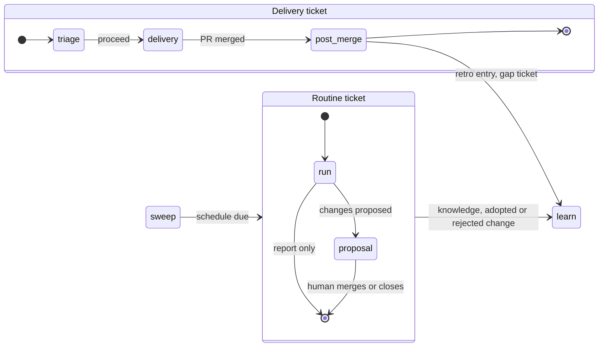
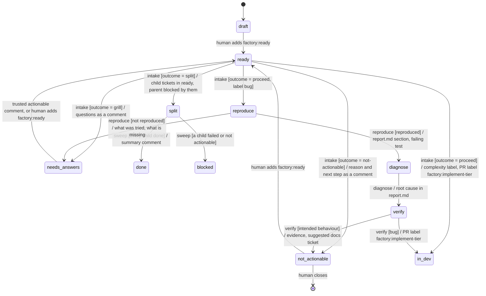
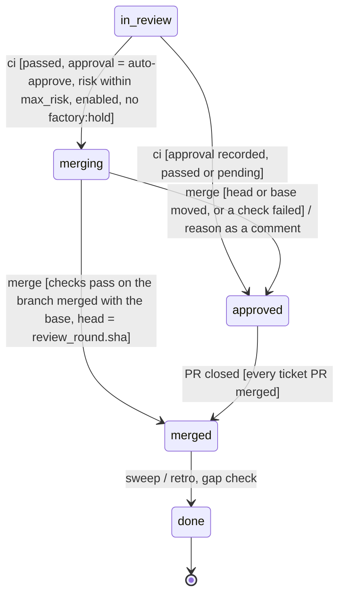
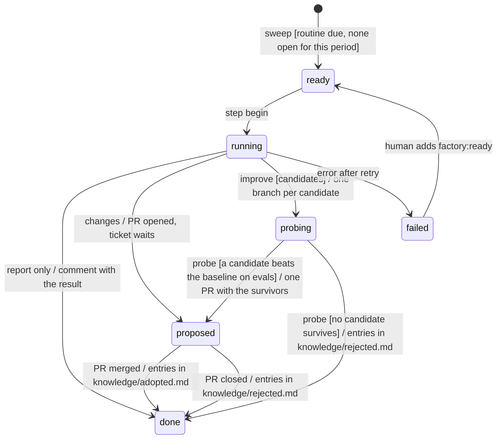

# Proposed state chart for the whole factory

Status is a proposal in #111 (30 October 2026). It extends [the delivery state chart](statechart.md)
and keeps its rules: the tracker label is the only state, one event starts one short step, and
`factory/step.py` owns every state decision. Nothing here changes slices #106 to #109. Each new part
is a later slice, listed under the delivery order below.

## What the factory does, end to end

Today the chart covers one thing. A ticket moves from `ready` to `done` through one PR. The factory
already does, or has tickets for, more than that:

- triage that ends in different outcomes (#88, #94, #95),
- a developer model chosen by complexity (#88),
- auto-merge when every gate passes (#91),
- a retro after each merge (#59),
- scheduled routines: metrics, digest, distill, cleanup (#10, #63),
- learning from its own runs: knowledge, gaps in the code, better prompts, calibrated judges (#63, #64, #65, #96).

These parts were built as driver features. Some are flags in the loop (`distill_every_days`), some are
extra intake fields, and one is a separate command (`drive.py distill`). This proposal turns each of them
into states and events in the same chart. One mechanism then schedules, retries, logs and shows all of
them.

## Two ticket kinds, two machines

Every unit of work is a ticket, and every ticket has one stage label.

| Kind | Chosen by | Machine | Example |
|---|---|---|---|
| Delivery | no `routine:*` label | `workflows/delivery.sm.yaml` | "Add a timestamped run log" |
| Routine | label `routine:<kind>` | `workflows/routine.sm.yaml` | "Weekly improve, 2026-W44" |

`step.py begin` picks the machine from the kind label. The router stays the one entry point (ADR-0002).
A routine ticket is created by the sweep from a schedule table. It is never written by a person, though
a person can open one by hand to run a routine early.



## Labels

Exactly one stage label is set at a time. Attribute labels describe the ticket and can be several.

| Label | Kind | Set by | Meaning |
|---|---|---|---|
| `factory:<stage>` | stage | the step, or a person for human transitions | the state |
| `risk:low`, `risk:high` | attribute | intake, raised by the join | blast radius; chooses the reviewers |
| `complexity:low`, `complexity:medium`, `complexity:high` | attribute | intake, or a person beforehand | effort; chooses the developer's model |
| `bug` | attribute | a person or intake | takes the bug path |
| `routine:<kind>` | attribute | the sweep | selects the routine machine |
| `factory:hold` | attribute | a person | no auto-merge; the ticket waits at `approved` |
| `factory:implement-<tier>`, `review:<focus>`, `factory:fix-<tier>` | PR command | the step | starts one automation, as in `statechart.md` |

A label a person set beforehand wins. Intake keeps an existing `complexity:*` label, as it already
keeps `risk:*`.

## Triage: from `ready` to work, a question, smaller tickets, or no work

Intake today answers `ready` and `risk`. The proposal turns its answer into one `outcome`, so every
triage result is a state, not a flag the driver interprets.



The outcomes:

| Outcome | State | Who acts next | Ticket |
|---|---|---|---|
| `proceed` | `in-dev`, or `reproduce` for a bug | the developer, on the tier of its complexity | #88, #95 |
| `grill` | `needs-answers` | a person answers; a trusted actionable comment resumes it | #88, #94 |
| `split` | `split` | the children run; the sweep closes the parent when all are done | #56, #88 |
| `not-actionable` | `not-actionable` | a person closes it or sets `ready` | #88 |

`needs-answers` replaces the use of `blocked` for questions. `blocked` keeps one meaning: the factory
tried and needs a person to unblock it. `split` replaces "parent `blocked` by its children". The sweep
can close a `split` parent on its own, and a `blocked` ticket would never get that.

The bug phases follow Astro's triage skill. Each phase is a fresh agent that reads only the previous
phase's section of `.factory/runs/<n>/report.md`. A model inclined to force a fix therefore gets no
chance to skip the "is this really a bug" question (#95).

## Complexity chooses the developer, and a failure climbs one tier

One Air automation runs one model (problem 18 in `statechart.md`). So the developer's command label
carries the tier: `factory:implement-cheap`, `factory:implement-mid`, `factory:implement-strong`, and the
same for `fix`. The Air renderer creates one automation per tier that a mapping actually uses:

```yaml
roles:
  developer:
    tier_by: complexity
    tiers: { low: cheap, medium: mid, high: strong }
    escalate: true          # a failed or malformed attempt reruns one tier higher, capped at strong
```

Today `mid` and `strong` are both Sonnet 5.5, so two automations exist. Pointing `models.strong` at Opus
later makes a third, and only `complexity:high` tickets pay for it.

Escalation is a transition, not a retry inside a run. `implement` with `error` and a tier below `strong`
sets the next tier's command label and counts toward `fix_round`. One wrong grade then costs one cheap
attempt, and the ticket still delivers.

## Delivery tail: auto-merge and the post-merge steps

The middle of delivery (`in-dev`, `in-review`, `changes-requested`, `approved`) stays as `statechart.md`
draws it. The proposal adds a `merging` state between `approved` and `merged`. This is the auto-merge
that `statechart.md` lists as out of scope.



`merging` is an agent state with a script step. It re-runs the blocking checks on the branch merged with
the current base, then runs `gh pr merge --match-head-commit`. When main moved, the ticket falls back to
`approved`, so parallel merges cannot break main. The policy and the judge stay as the recipe describes
them ([auto-approve recipe](recipes/auto-approve.md)).

The step that the sweep runs in `merged` does two things before `done`:

1. **Retro**, as today. One entry goes to the `knowledge-inbox` branch.
2. **Gap check.** If the ticket needed two or more fix rounds, climbed a tier, or went through `failed`,
   the step opens a ticket in `draft`. That ticket names the missing code comment, test or module
   boundary in the area the agent got wrong (#64, from the Astro post). It is `draft`, so a person decides
   whether it runs.

## Routines: scheduled work as tickets

The sweep reads one schedule table and opens a routine ticket when one is due. The ticket's title holds
the period (`Weekly improve, 2026-W44`), so a second sweep in the same period finds the open ticket and
opens nothing.

```yaml
routines:
  collect: { every: 1d, role: router, tier: cheap }        # metrics from the run log into knowledge (#63)
  digest:  { every: 1d, role: router, tier: cheap }        # one comment on #21: what moved, what waits on you (#10)
  audit:   { every: 1d, role: router, tier: cheap }        # stale leases, labels out of sync, orphan branches (#10)
  distill: { every: 7d, role: distill, tier: mid }         # knowledge inbox into knowledge/ as one PR
  improve: { every: 7d, role: improver, tier: mid }        # propose, probe, adopt (#64, #65)
  evals:   { every: 7d, script: factory/evals.py }         # the role eval suite, results in the run log (#96)
```



Cleanup does not get a ticket. Deleting merged branches and worktrees, and pruning old run directories,
is idempotent and has nothing to review, so the sweep does it inline.

## The four ways the factory learns

Every loop ends in a PR or a `draft` ticket that a person merges or promotes. The factory never changes
its own prompts, policies or config without that (ADR-0007). The auto-approve policy blocks
`policies/`, `judgments/`, `factory.yaml` and `.github/`, so these PRs can never auto-merge.

| Loop | Signal | Produced by | Lands as | Human step |
|---|---|---|---|---|
| Knowledge | every merged ticket | retro in `merged` | inbox entry, then the weekly `distill` PR into `knowledge/` | merge the distill PR |
| Code gaps | fix rounds ≥ 2, a tier climb, or `failed` | gap check in `merged` | a `draft` ticket naming the comment, test or boundary to add | set it `ready` |
| Harness | the week's run log and failures | `improve` routine: propose, probe on evals, adopt | one PR with the surviving prompt and config changes | merge it |
| Calibration | approver dry-run verdicts vs your merges; complexity grades vs attempts and cost | `collect` routine | a labelled set; a PR raising a judge threshold or changing the tier map | merge it |

The eval suite (#96) connects them. A prompt change counts as a win only when it beats the baseline on
recorded cases. Without that check, the harness loop could only guess.

## What this removes

Each new state replaces something the driver does today outside the chart.

- `split` and `needs-answers` replace two special uses of `blocked`, and the driver code that told them apart.
- `drive.py distill` and `knowledge.distill_every_days` become the `distill` routine.
- The planned metrics, digest and auditor (#10, #63) need no scheduler of their own. They become rows in `routines`.
- `--resume` from `blocked` and `failed` becomes the human transition to `ready`, as `statechart.md` already draws it.
- Escalation replaces the per-role `fallback` model that `statechart.md` lists as out of scope.

## Delivery order

These slices come after #106 to #109. Each ends in a state you can check with `sm.py simulate` and one real ticket.

1. Triage outcomes: the `outcome` enum, `needs-answers`, `split`, `not-actionable` (#88, rewritten to this chart).
2. Complexity labels, tiered command labels and escalation (#88, second half).
3. `routine.sm.yaml`, the schedule table in the sweep, and `distill` moved onto it. The `distill` command is then deleted.
4. `collect`, `digest` and `audit` as routines (#63, #10).
5. `merging` and the gap check (#91's merge step on `step.py`, and #64's gap rule).
6. Bug path: `reproduce`, `diagnose`, `verify` (#95).
7. `evals` and the `improve` routine with probing and adoption (#96, #64, #65).

## Open decisions

1. **Routine tickets in the tracker, or only in the run log.** Tickets make every routine visible and
   retryable with the same labels. The cost is about 15 tickets a week in the issue list. The proposal
   picks tickets and closes them on `done`.
2. **Does `not-actionable` close the ticket?** The proposal leaves it open for you to close, because the
   factory's reason can be wrong.
3. **Escalation and `fix_round`.** Counting a tier climb as a fix round keeps one cap on cost. A separate
   `tier_climbs` limit would let a ticket climb and still get its full fix rounds.
4. **The improver role.** It is new. The distill role could do it instead, with a different mode. That
   choice can wait for slice 7.
