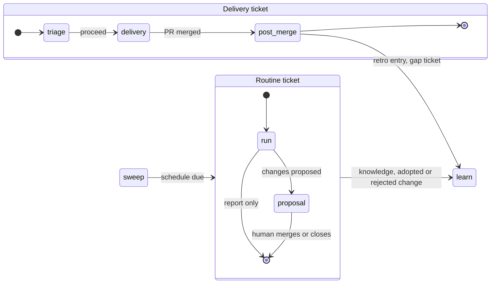
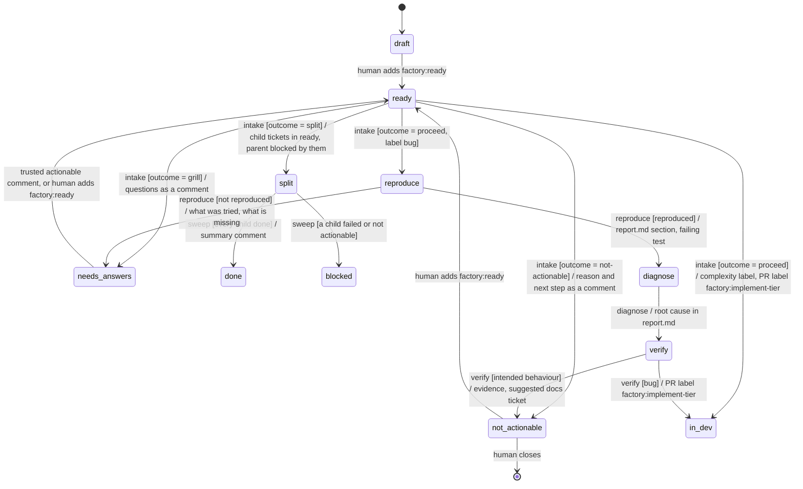
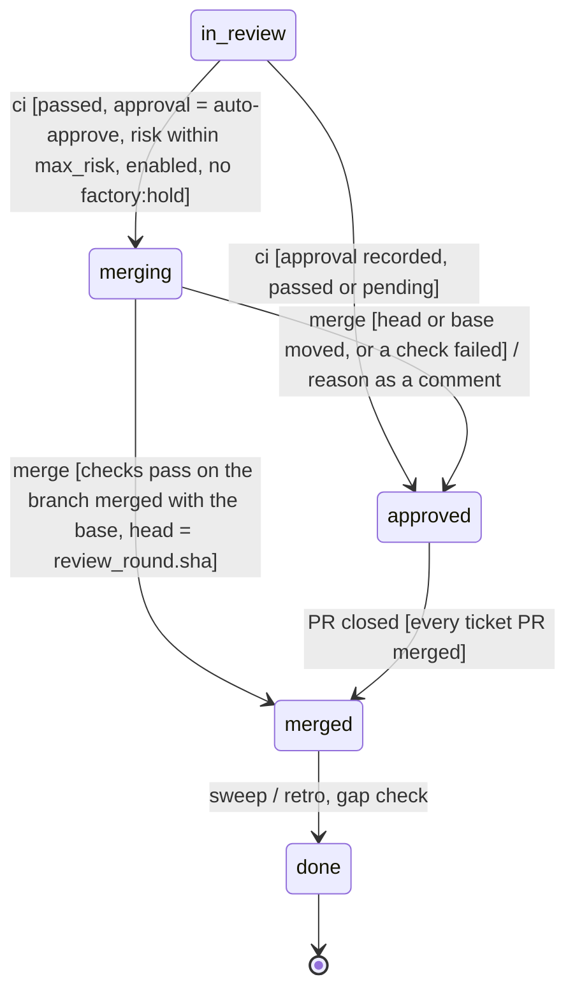
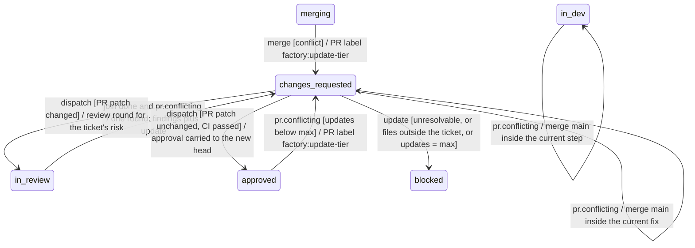
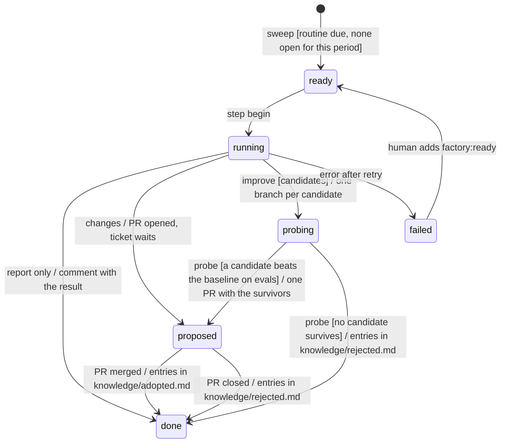

# Proposed state chart for the whole factory

> Superseded in mechanism by [ADR-0014](adr/0014-node-model.md) (nodes, facts and effects replace vars, leases and the earlier step script). The states and outcomes stay.

Status is a proposal in #111 (30 October 2026). It extends [the delivery state chart](statechart.md)
and keeps its rules: the tracker label is the only state, one event starts one short step, and
`factory/gate.py` owns every state decision. Nothing here changes slices #106 to #109. Each new part
is a later slice, listed under the delivery order below.

## The factory as nodes: built and planned

```mermaid
flowchart LR
    classDef stage fill:#eef,stroke:#669
    classDef node fill:#fff,stroke:#333
    classDef planned fill:#fafafa,stroke:#999,stroke-dasharray:5 5,color:#666
    classDef ext fill:#efe,stroke:#393
    N_human["<b>human</b><br/>on: a person<br/>human"]:::node
    N_intake["<b>intake</b><br/>on: issue +factory:triage<br/>router · cheap"]:::node
    N_start["<b>start</b><br/>on: issue +factory:ready<br/>script"]:::node
    N_investigate["<b>investigate</b> (#161)<br/>on: issue +factory:investigating<br/>developer · mid"]:::planned
    N_implement["<b>implement</b><br/>on: issue +factory:implement-{cheap|mid|strong}<br/>developer · cheap|mid|strong"]:::node
    N_adopt["<b>adopt</b> (#160)<br/>on: PR +factory:adopt<br/>router · cheap"]:::planned
    N_review["<b>review</b><br/>on: PR +factory:ci-green<br/>on: PR +factory:rereview-<focus><br/>reviewer · review tiers"]:::node
    N_join["<b>join</b><br/>on: PR review submitted<br/>on: PR +factory:ci-red<br/>script"]:::node
    N_fix["<b>fix</b><br/>on: PR +factory:fix-{cheap|mid|strong}<br/>developer · cheap|mid|strong"]:::node
    N_update["<b>update</b><br/>on: PR +factory:update-{cheap|mid|strong}<br/>developer · cheap|mid|strong"]:::node
    N_reopen["<b>reopen</b><br/>on: PR push<br/>on: PR +factory:ci-red<br/>script"]:::node
    N_merge["<b>merge</b><br/>on: issue +factory:approved<br/>on: PR +factory:ci-green<br/>script"]:::node
    N_finish["<b>finish</b><br/>on: PR merged<br/>on: issue closed<br/>on: issue +factory:blocked<br/>on: issues.comment<br/>script"]:::node
    N_notify["<b>notify</b><br/>on: issue +factory:blocked<br/>on: issue +factory:needs-answers<br/>script"]:::node
    N_recover["<b>recover</b><br/>on: cron 0 6,18 * * *<br/>script"]:::node
    N_retro["<b>retro</b><br/>on: cron 0 2 * * *<br/>retro · review tiers"]:::node
    N_distill["<b>distill</b><br/>on: cron 0 3 * * 1<br/>distill · review tiers"]:::node
    CI["<b>CI</b> quality-gates + ci-state.yml<br/>on: PR push<br/>writes +factory:ci-green or +factory:ci-red"]:::ext
    S_approved(["approved"]):::stage
    S_blocked(["blocked"]):::stage
    S_changes_requested(["changes-requested"]):::stage
    S_done(["done"]):::stage
    S_draft(["draft"]):::stage
    S_in_dev(["in-dev"]):::stage
    S_in_review(["in-review"]):::stage
    S_investigating(["investigating"]):::stage
    S_needs_answers(["needs-answers"]):::stage
    S_not_actionable(["not-actionable"]):::stage
    S_ready(["ready"]):::stage
    S_split(["split"]):::stage
    S_triage(["triage"]):::stage
    S_none(["PR with no stage"]):::stage
    S_draft --> N_human
    S_ready --> N_human
    S_in_dev --> N_human
    S_in_review --> N_human
    S_changes_requested --> N_human
    S_approved --> N_human
    S_blocked --> N_human
    S_needs_answers --> N_human
    S_split --> N_human
    S_not_actionable --> N_human
    S_investigating --> N_human
    N_human -- "triage" --> S_triage
    S_triage --> N_human
    N_human -- "ready" --> S_ready
    S_triage --> N_intake
    N_intake -- "proceed" --> S_ready
    N_intake -- "grill" --> S_needs_answers
    N_intake -- "split" --> S_split
    N_intake -- "not-actionable" --> S_not_actionable
    S_triage -.-> N_intake
    N_intake -. "bug (#161)" -.-> S_investigating
    S_ready --> N_start
    N_start -- "started +factory:implement-{tier}" --> S_in_dev
    S_investigating -.-> N_investigate
    N_investigate -. "bug" -.-> S_in_dev
    N_investigate -. "intended" -.-> S_not_actionable
    N_investigate -. "cannot-reproduce" -.-> S_needs_answers
    S_in_dev --> N_implement
    N_implement -- "done" --> S_in_review
    N_implement -- "error +factory:implement-{next}" --> S_in_dev
    N_implement -- "blocked" --> S_blocked
    N_implement -- "failed" --> S_blocked
    S_none -.-> N_adopt
    N_adopt -. "adopted" -.-> S_in_review
    S_in_review --> N_review
    S_in_review --> N_join
    N_join -- "changes +factory:fix-{tier}" --> S_changes_requested
    N_join -- "approved" --> S_approved
    S_changes_requested --> N_fix
    N_fix -- "done" --> S_in_review
    N_fix -- "blocked" --> S_blocked
    S_changes_requested --> N_update
    N_update -- "resolved" --> S_in_review
    N_update -- "escalate +factory:update-{next}" --> S_changes_requested
    N_update -- "unresolvable" --> S_blocked
    S_approved --> N_reopen
    N_reopen -- "reopened" --> S_in_review
    S_approved --> N_merge
    S_needs_answers --> N_finish
    N_finish -- "answered" --> S_triage
    S_split --> N_finish
    N_finish -- "children-done" --> S_done
    N_finish -- "child-blocked" --> S_blocked
    S_approved --> N_finish
    N_finish -- "conflict +factory:update-cheap" --> S_changes_requested
    N_finish -- "merged" --> S_done
    S_blocked --> N_notify
    S_needs_answers --> N_notify
    N_recover -- "blocked" --> S_blocked
    S_in_review -- "push" --> CI
    CI -- "+factory:ci-green" --> N_review
    CI -- "+factory:ci-red" --> N_join
    subgraph Legend
        L_s(["stage: label factory:‹stage›"]):::stage
        L_n["<b>built node</b><br/>on: the labels or events that start its automation"]:::node
        L_p["<b>planned node</b> (#ticket)"]:::planned
        L_s --> L_n
        L_n -- "outcome +label it adds" --> L_s
        L_s -.-> L_p
    end
```

Generated from `workflows/nodes.yaml` by `uv run factory/nodes.py chart` (ADR-0014); a test fails when it is stale. Rounded boxes are stages (the label `factory:<stage>`). Boxes are automation nodes, each with the labels or events that start it. Dashed nodes and edges are planned, with their ticket. Edge text is the outcome and the labels it adds.

<!-- nodes-chart -->


| Node | Starts on | Writes (labels it adds, stage it sets) | Role · tier | Status |
|---|---|---|---|---|
| `human` | `a person` | triage: → triage<br>ready: → ready | human | built |
| `intake` | `issue +factory:triage` | proceed: → ready<br>grill: → needs-answers<br>split: → split<br>not-actionable: → not-actionable<br>bug: → investigating (planned #161) | router · cheap | built |
| `start` | `issue +factory:ready` | started: +factory:implement-{tier} → in-dev | script | built |
| `investigate` | `issue +factory:investigating` | bug: → in-dev<br>intended: → not-actionable<br>cannot-reproduce: → needs-answers | developer · mid | planned #161 |
| `implement` | `issue +factory:implement-{cheap|mid|strong}` | done: → in-review<br>error: +factory:implement-{next} → in-dev<br>blocked: → blocked<br>failed: → blocked | developer · cheap/mid/strong | built |
| `adopt` | `PR +factory:adopt` | adopted: → in-review | router · cheap | planned #160 |
| `review` | `PR +factory:ci-green`<br>`PR +factory:rereview-<focus>` | approve: —<br>changes: — | reviewer · per focus | built |
| `join` | `PR review submitted`<br>`PR +factory:ci-red` | changes: +factory:fix-{tier} → changes-requested<br>approved: → approved<br>waiting: join | script | built |
| `fix` | `PR +factory:fix-{cheap|mid|strong}` | done: → in-review<br>blocked: → blocked | developer · cheap/mid/strong | built |
| `update` | `PR +factory:update-{cheap|mid|strong}` | resolved: → in-review<br>escalate: +factory:update-{next} → changes-requested<br>unresolvable: → blocked | developer · cheap/mid/strong | built |
| `reopen` | `PR push`<br>`PR +factory:ci-red` | reopened: → in-review | script | built |
| `merge` | `issue +factory:approved`<br>`PR +factory:ci-green` | merged: —<br>updated: —<br>waiting: — | script | built |
| `finish` | `PR merged`<br>`issue closed`<br>`issue +factory:blocked`<br>`issues.comment` | answered: → triage<br>children-done: → done<br>child-blocked: → blocked<br>conflict: +factory:update-cheap → changes-requested<br>merged: → done | script | built |
| `notify` | `issue +factory:blocked`<br>`issue +factory:needs-answers` | notified: — | script | built |
| `recover` | `cron 0 6,18 * * *` | blocked: → blocked | script | built |
| `retro` | `cron 0 2 * * *` | recorded: — | retro · per focus | built |
| `distill` | `cron 0 3 * * 1` | proposed: — | distill · per focus | built |
<!-- /nodes-chart -->

## What the factory does, end to end

Today the chart covers one thing. A ticket moves from `ready` to `done` through one PR. The factory
already does, or has tickets for, more than that:

- triage that ends in different outcomes (#88, #94, #95),
- a developer model chosen by complexity (#88),
- auto-merge when every gate passes (#91),
- a retro after each merge (#59),
- scheduled routines: metrics, digest, distill, cleanup (#10, #63),
- learning from its own runs: knowledge, gaps in the code, better prompts, calibrated judges (#63, #64, #65, #96).

These parts were built as driver features. Some are flags in the loop (`distill_every_days`), some are
extra intake fields, and one is a separate command (`drive.py distill`). This proposal turns each of them
into states and events in the same chart. One mechanism then schedules, retries, logs and shows all of
them.

## Two ticket kinds, two machines

Every unit of work is a ticket, and every ticket has one stage label.

| Kind | Chosen by | Machine | Example |
|---|---|---|---|
| Delivery | no `routine:*` label | `workflows/delivery.sm.yaml` | "Add a timestamped run log" |
| Routine | label `routine:<kind>` | `workflows/routine.sm.yaml` | "Weekly improve, 2026-W44" |

`gate.py` picks the machine from the kind label. The router stays the one entry point (ADR-0002).
A routine ticket is created by the sweep from a schedule table. It is never written by a person, though
a person can open one by hand to run a routine early.



## Labels

Exactly one stage label is set at a time. Attribute labels describe the ticket and can be several.

| Label | Kind | Set by | Meaning |
|---|---|---|---|
| `factory:<stage>` | stage | the step, or a person for human transitions | the state |
| `risk:low`, `risk:high` | attribute | intake, raised by the join | blast radius; chooses the reviewers |
| `complexity:low`, `complexity:medium`, `complexity:high` | attribute | intake, or a person beforehand | effort; chooses the developer's model |
| `bug` | attribute | a person or intake | takes the bug path |
| `routine:<kind>` | attribute | the sweep | selects the routine machine |
| `factory:hold` | attribute | a person | no auto-merge; the ticket waits at `approved` |
| `factory:implement-<tier>`, `review:<focus>`, `factory:fix-<tier>` | PR command | the step | starts one automation, as in `statechart.md` |

A label a person set beforehand wins. Intake keeps an existing `complexity:*` label, as it already
keeps `risk:*`.

## Triage: from `ready` to work, a question, smaller tickets, or no work

Intake today answers `ready` and `risk`. The proposal turns its answer into one `outcome`, so every
triage result is a state, not a flag the driver interprets.



The outcomes:

| Outcome | State | Who acts next | Ticket |
|---|---|---|---|
| `proceed` | `in-dev`, or `reproduce` for a bug | the developer, on the tier of its complexity | #88, #95 |
| `grill` | `needs-answers` | a person answers; a trusted actionable comment resumes it | #88, #94 |
| `split` | `split` | the children run; the sweep closes the parent when all are done | #56, #88 |
| `not-actionable` | `not-actionable` | a person closes it or sets `ready` | #88 |

`needs-answers` replaces the use of `blocked` for questions. `blocked` keeps one meaning: the factory
tried and needs a person to unblock it. `split` replaces "parent `blocked` by its children". The sweep
can close a `split` parent on its own, and a `blocked` ticket would never get that.

The bug phases follow Astro's triage skill. Each phase is a fresh agent that reads only the previous
phase's section of `.factory/runs/<n>/report.md`. A model inclined to force a fix therefore gets no
chance to skip the "is this really a bug" question (#95).

## Complexity chooses the developer, and a failure climbs one tier

One Air automation runs one model (problem 18 in `statechart.md`). So the developer's command label
carries the tier: `factory:implement-cheap`, `factory:implement-mid`, `factory:implement-strong`, and the
same for `fix`. The Air renderer creates one automation per tier that a mapping actually uses:

```yaml
roles:
  developer:
    tier_by: complexity
    tiers: { low: cheap, medium: mid, high: strong }
    escalate: true          # a failed or malformed attempt reruns one tier higher, capped at strong
```

Today `mid` and `strong` are both Sonnet 5.5, so two automations exist. Pointing `models.strong` at Opus
later makes a third, and only `complexity:high` tickets pay for it.

Escalation is a transition, not a retry inside a run. `implement` with `error` and a tier below `strong`
sets the next tier's command label and counts toward `fix_round`. One wrong grade then costs one cheap
attempt, and the ticket still delivers.

## Delivery tail: auto-merge and the post-merge steps

The middle of delivery (`in-dev`, `in-review`, `changes-requested`, `approved`) stays as `statechart.md`
draws it. The proposal adds a `merging` state between `approved` and `merged`. This is the auto-merge
that `statechart.md` lists as out of scope.



`merging` is an agent state with a script step. It re-runs the blocking checks on the branch merged with
the current base, then runs `gh pr merge --match-head-commit`. When main moved, the ticket falls back to
`approved`, so parallel merges cannot break main. The policy and the judge stay as the recipe describes
them ([auto-approve recipe](recipes/auto-approve.md)).

The step that the sweep runs in `merged` does two things before `done`:

1. **Retro**, as today. One entry goes to the `knowledge-inbox` branch.
2. **Gap check.** If the ticket needed two or more fix rounds, climbed a tier, or went through `failed`,
   the step opens a ticket in `draft`. That ticket names the missing code comment, test or module
   boundary in the area the agent got wrong (#64, from the Astro post). It is `draft`, so a person decides
   whether it runs.

## The fix round continues the developer's session

The join already waits for every reviewer. A round is complete when every focus in
`review_round.focuses` has a marker at `review_round.sha`. The fix round that follows should then run
in the session that implemented the ticket, which already holds the code, the decisions and the dead
ends. Locally this works today: `fix` has `session: resume`, and the harnesses pass
`--session-id factory-<n>-developer` (pi) or `--resume` (claude-code). In the step design every step is
a separate run, and an Air run starts on a fresh machine, so the session must travel with the ticket.

Air can continue an automation run's session (*proven*, 30 October, run `b725cf7e`). Each run reports
its Agent Spawner `sessionId` (`air-automations get_run`). `air-cloud resume_task` with that
`sessionId` and a prompt restarted the finished codex session: it answered from its earlier context, and
its context grew from 24.5k to 29k tokens. Three limits follow:

- Only the run's owner can resume it (AIRA-1548 asks for a service account). The factory does not hold
  the owner's Air credential, so **Air does not resume until AIRA-1548 lands** (#116). Until then a
  substantial round on Air starts a fresh session on the developer's model with `context.md`.
- A resumed session is not an automation run. No `push-to-source` happens at its end, so the agent pushes
  the fix itself with `gh`, and `dispatch` sees the `synchronize` event as usual. Whether the
  workspace and its credentials are still there after a long pause is an open check.
- `resume_task` takes a model (`sessionConfigOptions.model`), so a resumed session can change tier.

The developer step records a session pointer in the vars comment:

```json
{"session": {"target": "air", "harness": "codex", "model": "anthropic/claude-sonnet-5-5",
             "id": "d24bc908-...", "round": 1}}
```

### Which fix runs where

A fix does not always need the session that wrote the code. A cheap model can fix a typo, a lint
failure or a missing test name in a fresh session, and it reads only the findings and the diff. A
change to behaviour or design needs the author's context. The guard decides from the reviewers' JSON
markers and the CI result, not from a model's opinion:

| Fix round | Signal | Runs as |
|---|---|---|
| Small | every finding has `severity: minor`, or CI failed only on lint or format, and the findings name at most `limits.small_fix_files` files (default 3) | fresh session, `cheap` tier, with the findings, the diff and `context.md` |
| Substantial | any `severity: blocking` finding, a failing test, or a conflict in a file the PR changed | the developer's session resumed, same model |
| Repeated | the same `blocking_ids` as the previous round | fresh session on the developer's tier, one tier up when `escalate` is on |
| Session gone | resume fails, or `round` > `limits.resume_rounds` | fresh session on the developer's tier, with `context.md` |

The reviewer marker gains one field per finding, `severity: blocking | minor`. The reviewer already
decides that today in prose. A small fix that fails its checks becomes a substantial round, so a wrong
"small" costs one cheap attempt.

How each target resumes:

| | Local | Air |
|---|---|---|
| Resume | pi `--session-id factory-<n>-developer`, claude-code `--resume`, as today | none yet; after AIRA-1548, `resume_task(sessionId, prompt, model)` with a service account (#116) |
| Who pushes | the driver, as today | the platform (`push-to-source`); after #116, the resumed agent with `gh` |
| Fresh session | `run_role.py` with `context.md` | a `factory:fix-<tier>` automation run with `context.md` |

- **The handoff.** Every developer step also writes `context.md`: decisions, rejected approaches, files
  touched, open doubts. It goes into the handoff JSON (#84), so a fresh session always has it.
- **No session blobs.** Air keeps its own sessions, so the factory does not copy session files into git
  refs. This drops the blob level and its secret-scanning step.

## Merge conflicts: detected by the sweep, resolved by the developer

GitHub sends no event when a PR becomes conflicting. A push to main changes the PR's `mergeable`
state without a `synchronize` event. Both targets detect it the same way, in step code:

- The sweep reads `mergeable` for every open factory PR, and does so right after each merge to main.
  GitHub computes `mergeable` lazily, so a `null` is read again on the next sweep.
- The gates check it too: `dispatch` before a review round, `approve`, and `merging`.

A conflict raises the event `pr.conflicting`. The developer resolves it in an `update` step, started by
the command label `factory:update-<tier>`, with the session rules above:



- **Merge, not rebase.** The developer merges `origin/main` into the branch. No force-push is needed,
  which `push-to-source` may not allow (open check), and `review_round.sha` stays in history.
- **Re-review only when the PR's own change moved.** After the update, `dispatch` runs
  `git range-diff <old base>..<old head> <new base>..<new head>`. When the PR's patch is unchanged
  except for context lines, only CI runs again and the approval moves to the new head. When it changed,
  the focuses of the ticket's risk review it again.
- **Its own counter.** `updates`, capped by `limits.updates` (default 3), then `blocked`. A conflict is
  not the developer's fault, so it does not use up `fix_round`.
- **A clean base move needs nothing.** When main moved without a conflict, the PR waits until
  `merging`, which already tests the branch merged with the base.

Fewer conflicts cost less than resolving them:

- Intake predicts the paths a ticket will touch (`paths` in its handoff). The frontier does not start a
  ticket whose paths overlap an open delivery. The ticket stays `ready` until the other one merges.
- `merging` runs one PR at a time under the frontier lease, and the sweep checks the other PRs after
  each merge.

Both mechanisms are step code, so local and Air behave the same. The only difference is who calls the
sweep: launchd every 10 minutes locally, or a scheduled automation on Air.

## Routines: scheduled work as tickets

The sweep reads one schedule table and opens a routine ticket when one is due. The ticket's title holds
the period (`Weekly improve, 2026-W44`), so a second sweep in the same period finds the open ticket and
opens nothing.

```yaml
routines:
  collect: { every: 1d, role: router, tier: cheap }        # metrics from the run log into knowledge (#63)
  digest:  { every: 1d, role: router, tier: cheap }        # one comment on #21: what moved, what waits on you (#10)
  audit:   { every: 1d, role: router, tier: cheap }        # stale leases, labels out of sync, orphan branches (#10)
  distill: { every: 7d, role: distill, tier: mid }         # knowledge inbox into knowledge/ as one PR
  improve: { every: 7d, role: improver, tier: mid }        # propose, probe, adopt (#64, #65)
  evals:   { every: 7d, script: factory/evals.py }         # the role eval suite, results in the run log (#96)
```



Cleanup does not get a ticket. Deleting merged branches and worktrees, and pruning old run directories,
is idempotent and has nothing to review, so the sweep does it inline.

## The four ways the factory learns

Every loop ends in a PR or a `draft` ticket that a person merges or promotes. The factory never changes
its own prompts, policies or config without that (ADR-0007). The auto-approve policy blocks
`policies/`, `judgments/`, `factory.yaml` and `.github/`, so these PRs can never auto-merge.

| Loop | Signal | Produced by | Lands as | Human step |
|---|---|---|---|---|
| Knowledge | every merged ticket | retro in `merged` | inbox entry, then the weekly `distill` PR into `knowledge/` | merge the distill PR |
| Code gaps | fix rounds ≥ 2, a tier climb, or `failed` | gap check in `merged` | a `draft` ticket naming the comment, test or boundary to add | set it `ready` |
| Harness | the week's run log and failures | `improve` routine: propose, probe on evals, adopt | one PR with the surviving prompt and config changes | merge it |
| Calibration | approver dry-run verdicts vs your merges; complexity grades vs attempts and cost | `collect` routine | a labelled set; a PR raising a judge threshold or changing the tier map | merge it |

The eval suite (#96) connects them. A prompt change counts as a win only when it beats the baseline on
recorded cases. Without that check, the harness loop could only guess.

## What this removes

Each new state replaces something the driver does today outside the chart.

- `split` and `needs-answers` replace two special uses of `blocked`, and the driver code that told them apart.
- `drive.py distill` and `knowledge.distill_every_days` become the `distill` routine.
- The planned metrics, digest and auditor (#10, #63) need no scheduler of their own. They become rows in `routines`.
- `--resume` from `blocked` and `failed` becomes the human transition to `ready`, as `statechart.md` already draws it.
- Escalation replaces the per-role `fallback` model that `statechart.md` lists as out of scope.
- The session pointer brings back the resumed `fix` session that `statechart.md` drops for Air, and replaces the `session: resume` special case with one rule for both targets.

## Delivery order

These slices come after #106 to #109. Each ends in a state you can check with `sm.py simulate` and one real ticket.

1. Triage outcomes: the `outcome` enum, `needs-answers`, `split`, `not-actionable` (#88, rewritten to this chart).
2. Complexity labels, tiered command labels and escalation (#88, second half).
3. `routine.sm.yaml`, the schedule table in the sweep, and `distill` moved onto it. The `distill` command is then deleted.
4. `collect`, `digest` and `audit` as routines (#63, #10).
5. Session pointer, fix routing and handoff (#113), then conflict detection and `update` (#114).
6. `merging` and the gap check (#91's merge step on `gate.py`, and #64's gap rule).
7. Bug path: `reproduce`, `diagnose`, `verify` (#95).
8. `evals` and the `improve` routine with probing and adoption (#96, #64, #65).

## Open decisions

1. **Routine tickets in the tracker, or only in the run log.** Tickets make every routine visible and
   retryable with the same labels. The cost is about 15 tickets a week in the issue list. The proposal
   picks tickets and closes them on `done`.
2. **Does `not-actionable` close the ticket?** The proposal leaves it open for you to close, because the
   factory's reason can be wrong.
3. **Escalation and `fix_round`.** Counting a tier climb as a fix round keeps one cap on cost. A separate
   `tier_climbs` limit would let a ticket climb and still get its full fix rounds.
4. **The improver role.** It is new. The distill role could do it instead, with a different mode. That
   choice can wait for slice 7.
5. **Air resumes wait for AIRA-1548** (decided 30 October). No step holds the owner's Air credential.

## Open checks for the new parts

- How long a finished Air session stays resumable, and whether its workspace and `gh` login survive.
- Whether `push-to-source` accepts a merge commit from main.
- Whether a resumed session on a higher-tier model keeps its quality. `drive.py report` compares rounds.
