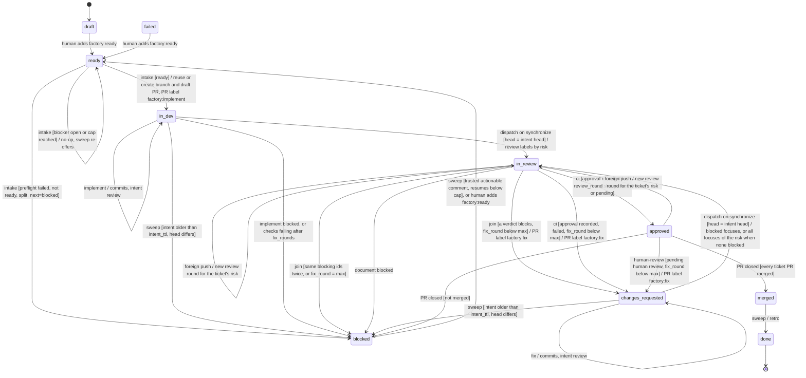

# Delivery state chart with tracker labels as state and events as triggers

Status is proposed in #100 (30 October 2026). Once accepted, it replaces the fork and loop constructs of
`workflows/delivery.sm.yaml` and supersedes ADR-0003. Every claim marked *proven* has a run linked from
#4 or #100. A claim marked *unverified* is a design assumption that the first implementation ticket checks.

The [proposed whole-factory chart](statechart-proposed.md) extends this one with triage outcomes, auto-merge, routines and the learning loops.

## What changes

In the earlier design, one run of the local driver walked a ticket from `ready` to `approved`. It kept fork, join and loop state in
`.factory/runs/`. In the new design the tracker label is the only state. Each GitHub event starts one
short step, and one step runs one role. A step ends by setting the label or PR label that starts the
next step, or by recording an intent that the next push applies.

- The fork is a set of PR labels, one per reviewer focus.
- The join is a guard that the last reviewer to finish evaluates.
- The loop is the `in-review` and `changes-requested` cycle, bounded by `fix_round`.

The same transition table drives both targets. On Air, GitHub events start automations. Locally,
the retired local driver polled the same events and called the same step code.

## The chart

Mermaid state names cannot contain `-`, so `in_dev` is the `factory:in-dev` label, and so on. Every
transition label names the event, then the guard in brackets, then the effect after `/`.



Four transitions are left out of the chart to keep it readable. They apply in every state that has a PR:

- A step that ends with `error` after its retry moves the ticket to `failed`.
- The sweep handles a lease older than `limits.lease_ttl`. For `in_review` with a complete round, it
  breaks the lease and runs the join again. In every other state, it re-fires the pending trigger once
  and then moves the ticket to `failed`. It deletes the lease in both cases.
- `pull_request.closed` with a merge moves the ticket to `merged` when every ticket PR is merged, and
  without a merge it moves the ticket to `blocked`. The command labels and the intent are removed.
- A human review that requests changes is recorded as pending by `human-review`. The join, the next
  `approved` entry, or the sweep turns it into a fix round.

Entering `blocked` or `failed` runs `diagnose` and `notify` in the same run as the step that entered it.
Entering `approved` runs `notify` and the router `summary`.

## Events and the automations they start

Issue labels hold the state, and exactly one `factory:*` stage label is set at a time. PR labels are
commands for the roles that push or review. A role that pushes must start from a `pull_request.*`
event, because only those triggers allow `push-to-source` (Air automation API).

| Automation | Event | Filter | Output | Role and model tier | Step |
|---|---|---|---|---|---|
| `intake` | `issues.labeled` | `label = factory:ready` | `create-pr` | router, cheap | preflight and intake under the frontier lease, then start: reuse or create branch `ez/<n>-<slug>` and a draft PR (the agent pushes and opens it in the run, *proven*), PR label `factory:implement`, state `in-dev` |
| `implement` | `pull_request.labeled` | `label = factory:implement` | `push-to-source` | developer, mid | implement, then the pre-review checks with in-run fixes; intent `review` |
| `dispatch` | `pull_request.synchronize` | none | `read-only` | script, cheap | when the new head equals the intent's head, apply the intent: state and command labels |
| `review-full`, `review-behaviour`, `review-structure-security` | `pull_request.labeled` | `label = review:<focus>` | `read-only` | reviewer, its focus tier | review `review_round.sha`, post a COMMENT review with a verdict marker, then try the join |
| `fix` | `pull_request.labeled` | `label = factory:fix` | `push-to-source` | developer, mid | fix and the pre-review checks; intent `review` |
| `human-review` | `pull_request_review.submitted` | `review_state = changes_requested` | `read-only` | script, cheap | record the review id as pending; start a fix round now when the state is `approved` |
| `document` | `pull_request.labeled` | `label = factory:document` | `push-to-source` | doc-writer, mid | update the docs; intent `approve` |
| `approve` | `pull_request.labeled` | `label = factory:approve` | `read-only`, with `JetBrains/jbeval` as an additional repository | approver script, cheap | hard rules and the decisions-kit verdict, publish (PR ready, body, ticket comment), then read CI once |
| `ci` | CI completed (unverified trigger, see below) | the quality-gates workflow | `read-only` | script, cheap | blocking checks on the branch merged with the base, then the PR's CI |
| `merged` | `pull_request.closed` | none | `read-only` | script, cheap | in any state with a PR: every ticket PR merged, state `merged`; closed without a merge, state `blocked` |
| `sweep` | scheduled, every 10 minutes | none | `as-instructed` | router, cheap | frontier offers, comment rechecks, pending triggers, lost joins, stale leases and intents, pending human reviews, CI backstop, retro, distill, cleanup |

Every automation has the same thin prompt. The prompt tells the agent to save the `<trigger_event>`
JSON to a file and run `factory/step.py begin` on it. If `begin` prints `SKIP`, the agent stops.
Otherwise it follows the role file that `begin` names, writes the handoff to the path `begin` gives, and
runs `factory/step.py end`. The agent does the role's work. The script owns every state decision.

## The step contract

`begin` and `end` are deterministic and safe to run twice. Neither trusts the event payload beyond the
ticket number and the event kind. Both read the current truth from GitHub.

`begin` does these checks in order and prints `SKIP` with the reason at the first one that fails:

1. Parse the event into the ticket, the event kind, the sender, and the PR head.
2. Read the stage labels. More than one stage label is legal only when a trusted human just made a
   human transition. In that case `begin` removes the other stage labels. Otherwise `begin` restores the
   last state the factory wrote (`state` in the vars comment) and reports the change on the ticket.
3. Find the transition for the state and the event in `workflows/delivery.sm.yaml`. No match means `SKIP`.
4. Check provenance. A stage or command label counts when it equals what the vars comment records:
   `state`, and one nonce for each command label that the last lease holder set. The executor's login
   does not matter, so Air runs, local runs, and the sweep need no login list. A label that does not
   match counts only as a human transition: `draft → ready`, `blocked → ready`, or `failed → ready`,
   set by an OWNER, MEMBER, or COLLABORATOR. `tracker.bot_logins` keeps its current meaning for comments.
5. Check that the ticket's PR is still open, except for the `merged` step.
6. Take the ticket lease. This is the ref `refs/factory/<n>/lease`, created through `POST git/refs`.
   The create call is atomic (*proven*: 201, then 422). The ref points to a commit whose message holds
   the holder and the time. On 422, `begin` prints `SKIP` and leaves the trigger in place, so the sweep
   can fire it again. Reviewers take no lease, because they write only their own review. `intake` also
   takes the frontier lease `refs/factory/_frontier/lease` while it checks blockers and the cap.
7. Consume the trigger. A command label is removed before the work starts, and an intent is cleared
   when `dispatch` applies it. A duplicate delivery then finds nothing to consume.

`gate.py check` (#107) returns the role's vendored skills next to `role_file`: `"skills":
["skills/vendor/<name>", ...]`, one per name in `roles/<role>/skills.txt`. The agent reads `role_file`, then each
`<dir>/SKILL.md`, and resolves the skill's relative links against its directory. Vendored skills stay out of
`.claude/skills/` and `.agents/skills/`, so no role auto-loads another role's skills.

`end` checks that the lease ref still points to its own commit, then reads the handoff, evaluates the
guards, writes the vars comment, sets the next state label and command labels with new nonces, runs the
`on_enter` actions of the new state, and deletes the lease. If the lease is gone, the sweep has already
failed the ticket, and `end` writes nothing.

## The fork, the join, and the loop as data

The fork is the set of review labels that `dispatch` adds, chosen by `risk`. A `low` ticket gets
`review:full`. A `high` ticket gets `review:behaviour` and `review:structure-security`. A re-review gets
only the focuses whose latest verdict blocked. When no focus blocked, as in a CI or human-review fix
round, the re-review gets every focus of the ticket's risk. `dispatch` stores the round as
`review_round: {sha, focuses}`, and each reviewer checks out `review_round.sha`, not the moving head.
A push that `dispatch` did not expect (a person pushed to the branch) starts a new round for the
ticket's risk in `in_review` and `approved`, so the reviewers always judge the code that would merge.

Each reviewer posts a COMMENT review with a hidden marker, then evaluates the join:

```text
<!-- factory-review {"focus": "behaviour", "sha": "<head>", "verdict": "changes-requested",
     "risk": "high", "docs_impact": "no", "blocking_ids": ["B1"]} -->
```

The join counts only markers from a `tracker.bot_logins` author at `review_round.sha`. If a focus has no
marker yet, the join stops and that reviewer's run ends. Each reviewer posts before it reads, so the last
one to finish sees every review. When two reviewers finish together, the lease lets one of them decide
and the other one stops. If the deciding run crashes, the sweep finds a complete round with no decision
and runs the join again.

The loop is the guard `fix_round < limits.fix_rounds` on every transition into `changes-requested`.
When the guard fails, the ticket moves to `blocked`. A repeat of the same `blocking_ids` in two rounds
also moves it to `blocked`.

The join keeps two values across rounds, as the current machine does with `out.<focus>`. `risk` becomes
the highest risk any marker reports, and it never goes down. `docs_impact` stays `yes` once any focus
reports it, so a re-review of one focus cannot drop the doc-writer.

## Problems found in the chart and how the design fixes them

The first draft of the chart had these defects. Each fix is part of the design above.

1. **A label can arrive before the push it depends on.** `push-to-source` pushes after the run ends
   (*proven*). A developer run that set `review:*` labels would start reviewers on the old head. The fix is this. a
   pushing role records an intent with the head it expects. `dispatch` applies the intent on
   `pull_request.synchronize` when the new head equals that head.
2. **A push role that commits nothing never fires `synchronize`.** A fix that changes nothing would
   stall the ticket. The fix is this. when the local head equals the remote head, `end` applies the intent directly.
3. **Adding a label that is already set fires no event.** A command label left behind by a crashed run
   would block the next round. The fix is this. `begin` removes its own command label before the work starts.
4. **The bot cannot approve its own PR** (*proven*). Reviewers post COMMENT reviews with a verdict
   marker, and the join reads the markers.
5. **Two reviewers that finish together can both decide, or neither.** The fix is this. post before reading, decide
   under the lease, and let the sweep repeat a lost join.
6. **Several steps writing the one vars comment lose updates.** The fix is this. only the lease holder writes vars.
   Reviewers write only their own review.
7. **Air may deliver an event twice** (`docs/targets.md`). The fix is this. the state check, the consumed trigger,
   and the lease make the second delivery a `SKIP`.
8. **A label trigger skips the frontier.** A person who marks five tickets `ready` would start five
   deliveries. That ignores blockers and `limits.concurrent_deliveries`. The fix is this. `intake` stops with the
   ticket still `ready` when a blocker is open or the cap is reached. The sweep offers it again later.
9. **A person can leave two stage labels.** Adding `factory:ready` to a `blocked` ticket keeps
   `factory:blocked`. The fix is this. `begin` keeps the label of a human transition and removes the old one.
10. **A person can set a factory-only label**, such as `factory:approved`, and skip the gates. The fix is this. the
    sender rule in `begin` restores the last factory state and reports the change.
11. **`read-only` does not stop labels, reviews, or comments.** Air's run instructions say that it limits
    version control only (*proven*). Whether credentials enforce even that is *unverified*. So the step
    script is the gate, and the ADR that accepts this design also replaces ADR-0011.
12. **CI can finish before `approve` publishes the PR.** No later CI event would come. The fix is this. `approve`
    reads the CI state once at its end. The sweep checks again for tickets that still wait.
13. **A PR closed without a merge left the ticket in `approved` forever.** The fix is this. the `merged` automation
    moves the ticket to `blocked`.
14. **The retro pushes to `knowledge-inbox`.** A `pull_request.closed` run can push only to the PR's own
    source branch. The fix is this. the sweep runs the retro for tickets in `merged`.
15. **A human review that asks for changes was never detected.** The fix is this. `fix` also starts on
    `pull_request_review.submitted` with `review_state = changes_requested`. The round counts toward
    `fix_round`.
16. **A crashed step leaves the lease and the intent behind.** The fix is this. the sweep moves a ticket to `failed`
    when its lease is older than `limits.lease_ttl`. The lease commit holds the time.
17. **Air and local runs act as different logins** (`jetbrains-air[bot]` and the user). The fix is
    problem 28. Trust follows the nonce in the vars comment, not the login.
18. **One automation has one model**, so `roles.developer.tier_high_risk` needs a second command label,
    `factory:implement-strong`, when the tiers differ. Today `mid` and `strong` are the same model, so
    one automation is enough.

An independent review of that draft found the next twelve. The fixes are in the design above.

19. **A CI event could move `in_review` to `approved` before any review.** CI for the pushed head can
    finish while the reviewers still work. The fix is this. every `ci` transition needs the approver's verdict for
    `review_round.sha`.
20. **Consuming the trigger before taking the lease lost the event on a 422.** The fix is this. `begin` takes the
    lease first. On 422 it leaves the trigger, and the sweep fires a pending trigger again.
21. **An intent that is never applied stalled the ticket.** The platform push can fail, or a person can
    push first. The fix is this. the sweep moves a ticket to `blocked` when its intent is older than
    `limits.intent_ttl` and the head differs. Reviewers review `review_round.sha`, and a push that
    `dispatch` did not expect starts a new round.
22. **A fix round with no blocking reviewer got an empty fork.** This happens in a CI or human-review fix
    round. The fix is this. the re-review then gets every focus of the ticket's risk, as in the current machine.
23. **Human reviews were dropped outside `approved` and doubled by duplicate deliveries.** The fix is this. a
    separate `human-review` step records the review id as pending. The review id makes it idempotent.
    The join, the `approved` entry, or the sweep starts the fix round.
24. **The doc-writer had no way back to `approve`**, and `document` blocked had no exit. The fix is this. `dispatch`
    applies intent `approve` in `in_review`, and `document` blocked moves the ticket to `blocked`.
25. **A PR closed or merged before `approved` had no transition.** The fix is this. `merged` applies in every state
    that has a PR, and `begin` checks that the PR is open.
26. **The stale-lease rule failed recoverable tickets and could be overwritten.** The fix is this. for a complete
    round the sweep runs the join again. It deletes the lease when it fails a ticket, and `end` writes
    nothing when its lease is gone. `limits.lease_ttl` and `limits.intent_ttl` are new.
27. **The chart dropped risk escalation and kept `docs_impact` for one round only.** The fix is this. both are
    sticky vars that the join updates.
28. **Trusting labels by login broke the meaning of `tracker.bot_logins`.** The sweep and local runs act
    as the user. The fix is this. trust a label by the nonce that the lease holder recorded, not by who set it.
29. **Two intakes could both pass the `concurrent_deliveries` cap.** The fix is this. `intake` checks the cap under
    the frontier lease. A resumed ticket reuses its branch and PR instead of creating them again.
30. **Some current behaviour had no place in the chart.** The out-of-scope list below now names it.

## Open checks

The first implementation ticket checks these before it relies on them:

- The filter key `review_state` on `pull_request_review.submitted`.
- The CI trigger: `workflow_run.completed` or `check_suite.completed`, and its filter keys.
- The event name and payload for a merged PR: `pull_request.closed` with `merged`, or `pull_request.merged`.
- Whether `pull_request.synchronize` fires for the platform's own push after a `push-to-source` run. The
  prototype saw the pushes land, and no automation listened for `synchronize` at the time.
- Whether Air deduplicates deliveries, and whether it limits concurrent runs per automation.
- Whether the agent saves the trigger payload byte for byte. `begin` uses only the ticket number and the
  event kind, and it reads everything else from GitHub, so a changed payload cannot move the ticket.

## Out of scope

- Tickets with PRs in several repositories. The Air target starts with one PR per ticket.
- Checking the branch merged with the base again after `approved`. A human merges after CI passes, as
  today.
- Auto-merge (`merge` with `done`, `moved`, and `failed`). It is off today (`auto_merge.enabled: false`).
  It returns as a `merge` step after `ci` in a later ticket.
- Model fallbacks (`roles.*.fallback`). One automation has one model. A fallback needs a second command
  label, such as `factory:fix-fallback`.
- A resumed developer session for `fix` (`session: resume`). An Air run starts fresh, so `fix` gets the
  findings and the PR diff instead.
- A retry for a run that dies before `end`. The sweep fires the pending trigger once more, then fails
  the ticket.

## Delivery order

Each slice is a factory ticket under #100 and ends in a state that can be checked:

1. The transition table in `workflows/delivery.sm.yaml`: states, events with their source, guards, and
   command labels, without `parallel` and `loop`. `sm.py validate` and `sm.py simulate` cover the table.
2. `factory/step.py`: `begin` and `end` with the GitHub adapter. The tests stub `gh` and cover each
   of the 30 numbered problems above.
3. The local target runs on `step.py`: the local driver (since retired) turned polled events into the same calls. The fork
   and loop engine code is deleted in the same change.
4. The Air target (#7): render the automations in the table from `delivery.sm.yaml` and `factory.yaml`.
5. The sweep on both targets.
6. The first ticket delivered end to end in Air (#8).

## Node chart

```mermaid
flowchart LR
    classDef stage fill:#eef,stroke:#669
    classDef node fill:#fff,stroke:#333
    classDef planned fill:#fafafa,stroke:#999,stroke-dasharray:5 5,color:#666
    classDef ext fill:#efe,stroke:#393
    N_human["<b>human</b><br/>on: a person<br/>human"]:::node
    N_intake["<b>intake</b><br/>on: issue +factory:ready<br/>router · cheap"]:::node
    N_investigate["<b>investigate</b> (#161)<br/>on: issue +factory:investigating<br/>developer · mid"]:::planned
    N_implement["<b>implement</b><br/>on: issue +factory:implement-{cheap|mid|strong}<br/>developer · cheap|mid|strong"]:::node
    N_adopt["<b>adopt</b> (#160)<br/>on: PR +factory:adopt<br/>router · cheap"]:::planned
    N_review["<b>review</b><br/>on: PR +factory:ci-green<br/>on: PR +factory:rereview-<focus><br/>reviewer · review tiers"]:::node
    N_join["<b>join</b><br/>on: PR review submitted<br/>on: PR +factory:ci-red<br/>script"]:::node
    N_fix["<b>fix</b><br/>on: PR +factory:fix-{cheap|mid|strong}<br/>developer · cheap|mid|strong"]:::node
    N_update["<b>update</b><br/>on: PR +factory:update-{cheap|mid|strong}<br/>developer · cheap|mid|strong"]:::node
    N_reopen["<b>reopen</b><br/>on: PR push<br/>on: PR +factory:ci-red<br/>script"]:::node
    N_merge["<b>merge</b> (#159)<br/>on: PR +factory:merge<br/>script"]:::planned
    N_finish["<b>finish</b><br/>on: PR merged<br/>on: issue closed<br/>on: issue +factory:blocked<br/>script"]:::node
    N_recover["<b>recover</b><br/>on: cron 0 6,18 * * *<br/>script"]:::node
    N_routines["<b>routines</b> (#162)<br/>on: cron 0 6 * * *<br/>distill · review tiers"]:::planned
    CI["<b>CI</b> quality-gates + ci-state.yml<br/>on: PR push<br/>writes +factory:ci-green or +factory:ci-red"]:::ext
    S_approved(["approved"]):::stage
    S_blocked(["blocked"]):::stage
    S_changes_requested(["changes-requested"]):::stage
    S_done(["done"]):::stage
    S_draft(["draft"]):::stage
    S_in_dev(["in-dev"]):::stage
    S_in_review(["in-review"]):::stage
    S_investigating(["investigating"]):::stage
    S_needs_answers(["needs-answers"]):::stage
    S_not_actionable(["not-actionable"]):::stage
    S_ready(["ready"]):::stage
    S_split(["split"]):::stage
    S_none(["PR with no stage"]):::stage
    S_draft --> N_human
    S_in_dev --> N_human
    S_in_review --> N_human
    S_changes_requested --> N_human
    S_approved --> N_human
    S_blocked --> N_human
    S_needs_answers --> N_human
    S_split --> N_human
    S_not_actionable --> N_human
    S_investigating --> N_human
    N_human -- "ready" --> S_ready
    S_ready --> N_intake
    N_intake -- "proceed +factory:implement-{tier}" --> S_in_dev
    N_intake -- "grill" --> S_needs_answers
    N_intake -- "split" --> S_split
    N_intake -- "not-actionable" --> S_not_actionable
    S_ready -.-> N_intake
    N_intake -. "bug (#161)" -.-> S_investigating
    S_investigating -.-> N_investigate
    N_investigate -. "bug" -.-> S_in_dev
    N_investigate -. "intended" -.-> S_not_actionable
    N_investigate -. "cannot-reproduce" -.-> S_needs_answers
    S_in_dev --> N_implement
    N_implement -- "done" --> S_in_review
    N_implement -- "error +factory:implement-{next}" --> S_in_dev
    N_implement -- "blocked" --> S_blocked
    N_implement -- "failed" --> S_blocked
    S_none -.-> N_adopt
    N_adopt -. "adopted" -.-> S_in_review
    S_in_review --> N_review
    S_in_review --> N_join
    N_join -- "changes +factory:fix-{tier}" --> S_changes_requested
    N_join -- "approved" --> S_approved
    S_changes_requested --> N_fix
    N_fix -- "done" --> S_in_review
    N_fix -- "blocked" --> S_blocked
    S_changes_requested --> N_update
    N_update -- "resolved" --> S_in_review
    N_update -- "escalate +factory:update-{next}" --> S_changes_requested
    N_update -- "unresolvable" --> S_blocked
    S_approved --> N_reopen
    N_reopen -- "reopened" --> S_in_review
    S_approved -.-> N_merge
    N_merge -. "update-or-hold" -.-> S_approved
    N_merge -. "fix +factory:fix-{tier}" -.-> S_changes_requested
    S_needs_answers -.-> N_finish
    N_finish -. "answered (#157)" -.-> S_ready
    S_split --> N_finish
    N_finish -- "children-done" --> S_done
    N_finish -- "child-blocked" --> S_blocked
    S_approved --> N_finish
    N_finish -- "conflict +factory:update-cheap" --> S_changes_requested
    N_finish -- "merged" --> S_done
    N_recover -- "blocked" --> S_blocked
    S_in_review -- "push" --> CI
    CI -- "+factory:ci-green" --> N_review
    CI -- "+factory:ci-red" --> N_join
    subgraph Legend
        L_s(["stage: label factory:‹stage›"]):::stage
        L_n["<b>built node</b><br/>on: the labels or events that start its automation"]:::node
        L_p["<b>planned node</b> (#ticket)"]:::planned
        L_s --> L_n
        L_n -- "outcome +label it adds" --> L_s
        L_s -.-> L_p
    end
```

Generated from `workflows/nodes.yaml` by `uv run factory/nodes.py chart` (ADR-0014); a test fails when it is stale. Rounded boxes are stages (the label `factory:<stage>`). Boxes are automation nodes, each with the labels or events that start it. Dashed nodes and edges are planned, with their ticket. Edge text is the outcome and the labels it adds.

<!-- nodes-chart -->


| Node | Starts on | Writes (labels it adds, stage it sets) | Role · tier | Status |
|---|---|---|---|---|
| `human` | `a person` | ready: → ready | human | built |
| `intake` | `issue +factory:ready` | proceed: +factory:implement-{tier} → in-dev<br>grill: → needs-answers<br>split: → split<br>not-actionable: → not-actionable<br>bug: → investigating (planned #161) | router · cheap | built |
| `investigate` | `issue +factory:investigating` | bug: → in-dev<br>intended: → not-actionable<br>cannot-reproduce: → needs-answers | developer · mid | planned #161 |
| `implement` | `issue +factory:implement-{cheap|mid|strong}` | done: → in-review<br>error: +factory:implement-{next} → in-dev<br>blocked: → blocked<br>failed: → blocked | developer · cheap/mid/strong | built |
| `adopt` | `PR +factory:adopt` | adopted: → in-review | router · cheap | planned #160 |
| `review` | `PR +factory:ci-green`<br>`PR +factory:rereview-<focus>` | approve: —<br>changes: — | reviewer · per focus | built |
| `join` | `PR review submitted`<br>`PR +factory:ci-red` | changes: +factory:fix-{tier} → changes-requested<br>approved: → approved<br>waiting: join | script | built |
| `fix` | `PR +factory:fix-{cheap|mid|strong}` | done: → in-review<br>blocked: → blocked | developer · cheap/mid/strong | built |
| `update` | `PR +factory:update-{cheap|mid|strong}` | resolved: → in-review<br>escalate: +factory:update-{next} → changes-requested<br>unresolvable: → blocked | developer · cheap/mid/strong | built |
| `reopen` | `PR push`<br>`PR +factory:ci-red` | reopened: → in-review | script | built |
| `merge` | `PR +factory:merge` | merged: —<br>update-or-hold: → approved<br>fix: +factory:fix-{tier} → changes-requested | script | planned #159 |
| `finish` | `PR merged`<br>`issue closed`<br>`issue +factory:blocked` | answered: → ready (planned #157)<br>children-done: → done<br>child-blocked: → blocked<br>conflict: +factory:update-cheap → changes-requested<br>merged: → done | script | built |
| `recover` | `cron 0 6,18 * * *` | blocked: → blocked | script | built |
| `routines` | `cron 0 6 * * *` | proposed: — | distill · per focus | planned #162 |
<!-- /nodes-chart -->

## Status of problems 1-30 in the gate

`factory/gate.py` (ADR-0014 nodes) replaces `begin`/`end`. *check* = `gate.py check`, *apply* = `gate.py apply`,
*node* = a node in `workflows/nodes.yaml`, *sweep* = the `sweep` node, *adapter* = the tracker adapter (#172),
*join* = the join slice (#173), *rounds* = bounded rounds (#155).

| # | Status | Where |
|---|---|---|
| 1 | moved to a node | `implement` pushes, `review` is triggered by `synchronize`; `check` refuses a stale head |
| 2 | moved to a node | `implement` outcome `done` sets the stage directly, no label race |
| 3 | dropped | no command label is consumed; the node condition is the gate |
| 4 | moved to a node | `review` posts a marker review (adapter, join) |
| 5 | moved to a node | `join` is idempotent; the sweep repeats it (join) |
| 6 | dropped | no vars comment; facts are read from the tracker each time |
| 7 | solved by check | duplicate event id exits 10 (`seen`, written with the stage change, or by a `seen` effect that apply appends when the outcome has no stage effect) |
| 8 | solved by check | `blockers: closed` in `intake.when`; the sweep re-offers |
| 9 | solved by apply | the stage effect replaces the stage (a tag swap on the tag tracker) |
| 10 | moved to the adapter | the adapter reports the actor; `when: {actor}` |
| 11 | solved by apply | the script is the only writer; roles are read-only |
| 12 | moved to the sweep | the sweep re-checks CI for waiting tickets |
| 13 | moved to the sweep | closed unmerged PR handled by the `merging` node / sweep |
| 14 | moved to the sweep | retro runs from the sweep for `merged` |
| 15 | moved to a node | `join` (join) |
| 16 | moved to the sweep | stale work found by the sweep; no lease in this design |
| 17 | dropped | trust follows the facts, not the login |
| 18 | moved to a node | `tiers` of `implement` and `fix` |
| 19 | solved by check | `round: complete-at-head` and `ci: green` in `when` |
| 20 | dropped | no trigger is consumed |
| 21 | solved by check | `check` refuses a head that is not the event's head |
| 22 | moved to a node | `review.focus: required-by-risk` (join) |
| 23 | moved to a node | `join` (join) |
| 24 | moved to a node | `doc-writer` node, later slice |
| 25 | moved to the sweep | sweep |
| 26 | dropped | no lease |
| 27 | moved to a node | risk is a `set-field` effect; sticky rules in join / rounds |
| 28 | dropped | see 17 |
| 29 | moved to a node | cap check in `intake` (adapter) |
| 30 | moved to the sweep | out-of-scope list above, plus the sweep |

Also solved by apply: a repeated apply writes nothing (each effect reads first), a failing effect leaves the
stage unchanged (the stage is the last effect), and a payload missing a field exits 2 naming it.
The `when` vocabulary is `stage`, `blockers`, `focus`, `round`, `fix-rounds`, `ci`, `actor`, `always`, `due`;
`same-repo` and `draft` (node `adopt`) are filters of the adapter's trigger, and `marked-review-at-head` and
`open-fix` are part of `focus: required-by-risk`.
