# Workflow: delivery

The per-ticket loop (design §5, §6). The definition is the node list in
`engine/nodes.yaml` ([ADR-0014](../docs/adr/0014-node-model.md)): each node
is a `[factory:<node>]` Air automation, started by a label or a PR event, that
runs `uv run factory/gate.py check`, does its role's work, writes its handoff
and runs `gate.py apply`. The gate moves the stage; the stage labels and the
tracker operations are in `docs/agents/issue-tracker.md`. Names of
repositories, stages, models and checks come from the team descriptor (`factory.project.yaml` or `factory.descriptor.yaml`).

By hand, use the `factory-delivery` skill: it runs one node the same way.

## State chart

The chart and the node table below are generated from `factory.project.yaml` and `workflows/delivery.yaml`.
Each arrow is `node · outcome`, and `+cmd` or `-cmd` is the command the outcome adds or removes. A grey dashed
state is off. The factory-setup skill's `scripts/state_chart.py write` regenerates the block; its `verify`
fails when the block is stale, a state cannot be reached, or an active state has no way out.

```mermaid
stateDiagram-v2
    classDef waiting fill:#fff8e6,stroke:#c90
    classDef final fill:#eef7ee,stroke:#393
    classDef off fill:#f4f4f4,stroke:#999,stroke-dasharray:5 5,color:#777
    state "draft" as s_draft
    state "triage" as s_triage
    state "ready" as s_ready
    state "in-dev" as s_in_dev
    state "in-review" as s_in_review
    state "changes-requested" as s_changes_requested
    state "approved" as s_approved
    state "done" as s_done
    state "blocked" as s_blocked
    state "needs-answers" as s_needs_answers
    state "split" as s_split
    state "not-actionable" as s_not_actionable
    state "investigating" as s_investigating
    state "ci-red" as s_ci_red
    state "ci-green" as s_ci_green
    state "pr-merged" as s_pr_merged
    state "any state" as s_any
    [*] --> s_draft
    [*] --> s_ci_red
    [*] --> s_ci_green
    [*] --> s_pr_merged
    s_draft --> s_triage : human · triage
    s_ready --> s_triage : human · triage
    s_in_dev --> s_triage : human · triage
    s_in_review --> s_triage : human · triage
    s_changes_requested --> s_triage : human · triage
    s_approved --> s_triage : human · triage
    s_blocked --> s_triage : human · triage
    s_needs_answers --> s_triage : human · triage
    s_split --> s_triage : human · triage
    s_not_actionable --> s_triage : human · triage
    s_draft --> s_ready : human · ready
    s_triage --> s_ready : human · ready
    s_in_dev --> s_ready : human · ready
    s_in_review --> s_ready : human · ready
    s_changes_requested --> s_ready : human · ready
    s_approved --> s_ready : human · ready
    s_blocked --> s_ready : human · ready
    s_needs_answers --> s_ready : human · ready
    s_split --> s_ready : human · ready
    s_not_actionable --> s_ready : human · ready
    s_triage --> s_ready : intake · proceed
    s_triage --> s_needs_answers : intake · grill
    s_triage --> s_split : intake · split
    s_triage --> s_not_actionable : intake · not-actionable
    s_ready --> s_in_dev : start · started / +implement-{tier}
    s_in_dev --> s_in_review : implement · done / -implement-*
    s_in_dev --> s_in_dev : implement · error / +implement-{next tier}, -implement-*
    s_in_dev --> s_blocked : implement · blocked
    s_in_dev --> s_blocked : implement · failed
    s_in_dev --> s_ready : implement · env-broken / -implement-*
    s_in_review --> s_changes_requested : join · changes / +fix-{tier}
    s_in_review --> s_approved : join · approved
    s_changes_requested --> s_in_review : fix · done / -fix-*
    s_changes_requested --> s_blocked : fix · blocked
    s_changes_requested --> s_ready : fix · env-broken / -fix-*
    s_changes_requested --> s_in_review : fix · nothing-to-fix / -fix-*
    s_changes_requested --> s_in_review : update · resolved / -update-*
    s_changes_requested --> s_changes_requested : update · escalate / +update-{next tier}, -update-*
    s_changes_requested --> s_blocked : update · unresolvable / -update-*
    s_approved --> s_in_review : reopen · reopened
    s_needs_answers --> s_triage : finish · answered
    s_split --> s_done : finish · children-done
    s_split --> s_blocked : finish · child-blocked
    s_approved --> s_changes_requested : finish · conflict / +update-cheap
    s_draft --> s_done : finish · merged
    s_triage --> s_done : finish · merged
    s_ready --> s_done : finish · merged
    s_in_dev --> s_done : finish · merged
    s_in_review --> s_done : finish · merged
    s_changes_requested --> s_done : finish · merged
    s_approved --> s_done : finish · merged
    s_blocked --> s_done : finish · merged
    s_needs_answers --> s_done : finish · merged
    s_split --> s_done : finish · merged
    s_any --> s_blocked : recover · blocked
    s_done --> [*]
    s_pr_merged --> [*]
    class s_draft,s_blocked,s_needs_answers waiting
    class s_done,s_not_actionable,s_pr_merged final
    class s_investigating off
```

<!-- state-chart:begin -->

| Node | Wakes on | Role | Environment |
|---|---|---|---|
| `human` | `manual` | human | - |
| `intake` | `state triage` | router | read |
| `start` | `state ready` | script | read |
| `investigate (off)` | `state investigating` | developer | write |
| `implement` | `command implement-<tier>` | developer | write |
| `adopt (off)` | `command adopt` | router | read |
| `review` | `command review-<focus>` `command rereview-<focus>` | reviewer | read |
| `join` | `pr reviewed` `state ci-red` | script | read |
| `fix` | `command fix-<tier>` | developer | write |
| `update` | `command update-<tier>` | developer | write |
| `reopen` | `pr pushed` `state ci-red` | script | read |
| `merge` | `state approved` `state ci-green` | script | read |
| `finish` | `state pr-merged` `ticket closed` `state blocked` `ticket commented` | script | read |
| `recover` | `manual` | script | read |
| `reconcile` | `schedule reconcile` | script | ops |
| `doctor` | `schedule doctor` | script | read |
| `doctor-write` | `schedule doctor` | script | write |
| `doctor-ops` | `schedule doctor` | script | ops |
| `retro` | `schedule retro` | retro | ops |
| `distill` | `schedule distill` | distill | ops |
<!-- state-chart:end -->

## Input

A tracker ticket in stage `ready`.

## Handoffs

Each agent step ends with the structured block its role file defines. Steps
pass these blocks, never transcripts. The reviewer always starts fresh.

## External writes

Every push, label change, PR and comment carries the `[factory]` marker and a
`Factory-Run:` trailer. While `gates.confirm_external_writes` is `true`, each
write kind in `gates.confirm_external_writes_scope` is shown and waits for the
user's approval; a declined write stops the run with stage unchanged. Other
writes, including the push of the ticket's own branch, are auto-approved.
Merging stays with the human (`gates.pr_approval`).
